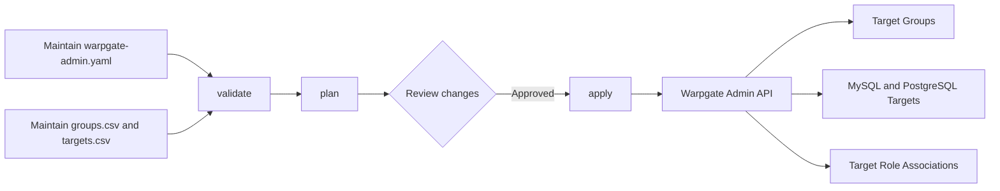

# Warpgate Admin

`warpgate-admin` declares Warpgate resources from one YAML runtime configuration file and two CSV inventory files:

- `warpgate-admin.yaml` configures the Warpgate connection, CSV paths, and apply policies.
- `groups.csv` manages Warpgate Target Groups, such as `<environment>-<region>`.
- `targets.csv` manages RDS targets within those groups and can associate each target with existing Warpgate roles.

MySQL and PostgreSQL RDS targets are currently supported. The tool provides the following commands:

- `validate` validates both CSV files without accessing Warpgate or resolving `password_env` values.
- `plan` queries the Warpgate Admin API, resolves password references, and shows the resources and associations that would be created, updated, or removed.
- `apply` creates or updates Target Groups and RDS Targets, adds or synchronizes target-role associations according to the configuration, and can optionally delete RDS Targets that are absent from the inventory.

`apply` never deletes Target Groups. `apply.sync_targets` defaults to `false`, so RDS Targets that are missing from the CSV or represented by rows with `enabled=false` remain unchanged in Warpgate. When explicitly enabled, each enabled Group in `groups.csv` becomes part of the synchronization scope, and MySQL or PostgreSQL Targets within that scope are deleted when they are absent from `targets.csv`. Other Target types, such as SSH and Kubernetes, are never deleted. Target-role associations are additive by default; when `apply.sync_roles` is explicitly enabled, the `roles` column becomes the desired role set.

## Workflow



## groups.csv

| Column | Required | Description |
| --- | --- | --- |
| `enabled` | No | Defaults to `true` when empty. `false` ignores the Group and excludes it from the target synchronization scope. |
| `name` | Yes | Unique Target Group name, up to 255 characters. |
| `description` | No | Group description. |
| `color` | No | One of `Primary`, `Secondary`, `Success`, `Danger`, `Warning`, `Info`, `Light`, or `Dark`. |

See [groups.example.csv](groups.example.csv) for a template.

## targets.csv

| Column | Required | Description |
| --- | --- | --- |
| `enabled` | No | Defaults to `true` when empty. `false` ignores the row. When `apply.sync_targets` is enabled, an existing RDS Target with the same name is deleted because it is absent from the desired inventory. |
| `group` | Yes | Name of an enabled group in `groups.csv`. |
| `name` | Yes | Unique Warpgate Target name, up to 255 characters. |
| `description` | No | Target description. |
| `roles` | No | Names of existing Warpgate roles, separated by `;`, for example `<role-name-1>;<role-name-2>`. Associations are additive by default; with `apply.sync_roles` enabled, this becomes the complete desired role set. |
| `engine` | Yes | `mysql` or `postgres`. |
| `host` | Yes | RDS endpoint hostname without a port. |
| `port` | Yes | Database port from `1` to `65535`. |
| `username` | Yes | Database username. |
| `password` | Conditionally | Plaintext database password. Only one of `password` and `password_env` may be set. Both may be empty for MySQL to use an empty password. |
| `password_env` | Conditionally | Environment variable containing the database password. Only one of `password` and `password_env` may be set. PostgreSQL requires one of them. |
| `tls_mode` | No | `disabled`, `preferred`, or `required`. Defaults to `required` when empty. |
| `tls_verify` | No | Whether to verify the TLS certificate. Defaults to `true` when empty. |
| `default_database_name` | No | Default MySQL or PostgreSQL database. |
| `protocol_version` | No | PostgreSQL protocol version `3.0` or `3.2`. Must be empty for MySQL. |

See [targets.example.csv](targets.example.csv) for a template.

The CSV files must contain every template column except `roles`. The `roles` column itself may be omitted for compatibility with older `targets.csv` files. Columns may appear in any order, but unknown columns are rejected. Blank rows are ignored.

When associating roles with a target, `plan` and `apply` first look up existing Warpgate roles by name. The command stops with an error if a role does not exist. The Admin API token must be authorized to assign access roles.

`apply.sync_roles` defaults to `false`, so `apply` only adds missing associations and never removes existing ones. When set to `true`:

- If the `roles` column is absent, role associations are not managed for any target in that CSV file.
- If the `roles` column is present and nonempty, missing roles are added and unlisted roles are removed.
- If the `roles` column is present but a cell is empty, all roles are removed from that target.

```csv
enabled,group,name,description,roles,engine,host,port,username,password,password_env,tls_mode,tls_verify,default_database_name,protocol_version
true,<group-name>,<target-name>,<description>,<role-name-1>;<role-name-2>,mysql,<rds-endpoint>,<port>,<username>,,TARGET_PASSWORD_ENV_VAR,required,true,,
```

## Password management

The tool accepts a plaintext password in the `password` column. However, a CSV file containing plaintext passwords must not be committed to Git or shared through ordinary chat or email.

A MySQL target may leave both `password` and `password_env` empty to use an empty password. A PostgreSQL target must still provide one of them.

For files committed to Git, use an environment variable reference in `targets.csv`:

```csv
enabled,group,name,description,engine,host,port,username,password,password_env,tls_mode,tls_verify,default_database_name,protocol_version
true,<group-name>,<target-name>,<description>,mysql,<rds-endpoint>,<port>,<username>,,RDS_TARGET_PASSWORD,required,true,,
```

Set the actual password before running `plan` or `apply`:

```shell
export RDS_TARGET_PASSWORD='<database-password>'
```

If a plaintext password must be stored locally in a CSV file, use `targets.local.csv`. This file is excluded by `.gitignore`.

## Build

Go 1.26 or later is required:

```shell
go build -o warpgate-admin ./cmd/warpgate-admin
```

## YAML configuration

Copy the template and provide the actual endpoint and inventory paths:

```shell
cp warpgate-admin.example.yaml warpgate-admin.yaml
```

The configuration has the following structure:

```yaml
warpgate:
  host: https://<warpgate-host>
  token: <warpgate-token>
  insecure_skip_verify: false

inventory:
  groups: groups.csv
  targets: targets.csv

apply:
  update_passwords: false
  sync_roles: false
  sync_targets: false
```

| Field | Required | Description |
| --- | --- | --- |
| `warpgate.host` | For `plan` and `apply` | Warpgate root URL or an API URL containing `/@warpgate/admin/api`. |
| `warpgate.token` | For `plan` and `apply` | Warpgate Admin API token. |
| `warpgate.insecure_skip_verify` | No | Whether to skip TLS certificate verification for the Warpgate Admin API. Defaults to `false`. |
| `inventory.groups` | Yes | Path to the groups CSV file. |
| `inventory.targets` | Yes | Path to the targets CSV file. |
| `apply.update_passwords` | No | Whether to force password updates for every managed RDS target by default. Defaults to `false`. |
| `apply.sync_roles` | No | Whether to treat the `roles` column as the complete desired set and remove extra associations. Defaults to `false`. |
| `apply.sync_targets` | No | Whether to delete MySQL and PostgreSQL Targets that are absent from the targets CSV within enabled Groups. Defaults to `false`. |

Relative CSV paths are resolved from the directory containing the YAML file. Unknown YAML fields are rejected, so misspelled fields cause an error. Warpgate `host`, `token`, and `insecure_skip_verify` values are read only from YAML and cannot be overridden by environment variables. The `--groups`, `--targets`, and `--update-passwords` flags can override or augment the YAML inventory and apply settings.

The production configuration contains credentials and is excluded as `warpgate-admin.yaml` by `.gitignore`. Restrict it to owner read and write permissions:

```shell
chmod 600 warpgate-admin.yaml
```

`insecure_skip_verify` disables TLS certificate verification for the Warpgate Admin API. It is unrelated to `tls_mode` and `tls_verify`, which control RDS connections in `targets.csv`.

## Usage

Validate the configuration and both inventory files:

```shell
./warpgate-admin validate --config warpgate-admin.yaml
```

Preview changes:

```shell
./warpgate-admin plan --config warpgate-admin.yaml
```

Apply the reviewed plan:

```shell
./warpgate-admin apply --config warpgate-admin.yaml
```

Target names are stable reconciliation keys. Repeatedly applying the same inventory is idempotent. `plan` uses `+` for creates or new associations, `~` for updates, and `-` for removals, and never prints database passwords.

When credential encryption is enabled in Warpgate, the Admin API returns only an encrypted envelope and cannot be used to determine whether the source password has changed. By default, `plan` treats that password as incomparable while remaining idempotent. To rotate passwords for existing RDS targets, explicitly run:

```shell
./warpgate-admin plan --config warpgate-admin.yaml --update-passwords
./warpgate-admin apply --config warpgate-admin.yaml --update-passwords
```

This option forces a password update for every existing enabled RDS target in `targets.csv`. It can also be enabled temporarily with `apply.update_passwords: true` in YAML. New targets always receive their configured password and do not require this option.

To fully synchronize Warpgate RDS Targets with the CSV inventory, explicitly enable:

```yaml
apply:
  sync_targets: true
```

The synchronization scope consists of enabled Groups in the current `groups.csv`. For each MySQL or PostgreSQL Target within that scope:

- If a target with the same name exists in `targets.csv`, it is created or updated.
- If it is absent from `targets.csv`, or its row has `enabled=false`, `plan` marks it with `-` and `apply` deletes it.
- If the Target belongs to another Group or has a non-RDS type such as SSH or Kubernetes, it remains unchanged.

If Test and Production use different targets CSV files, use a corresponding groups CSV file for each environment to prevent one synchronization run from affecting the other environment's Groups. Renaming a Target appears as creating the new name and deleting the old one. Review every deletion in `plan` before running `apply`. The Admin API token must be authorized to delete Targets.

YAML is optional when only validating CSV files:

```shell
./warpgate-admin validate --groups groups.csv --targets targets.csv
```

`plan` and `apply` require a Warpgate connection supplied through `--config`.

When updating an existing target, the tool preserves rate limits and ticket policies that are not managed by the CSV inventory. It refuses to replace a same-named SSH, Kubernetes, or other Target type with an RDS Target, and it also refuses to switch between MySQL and PostgreSQL.

The Warpgate Admin API does not provide transactions. If an `apply` operation fails partway through, successful changes are not rolled back automatically. Fix the error, then rerun `plan` and `apply` to continue converging toward the desired state.

## Test

```shell
go test ./...
```
