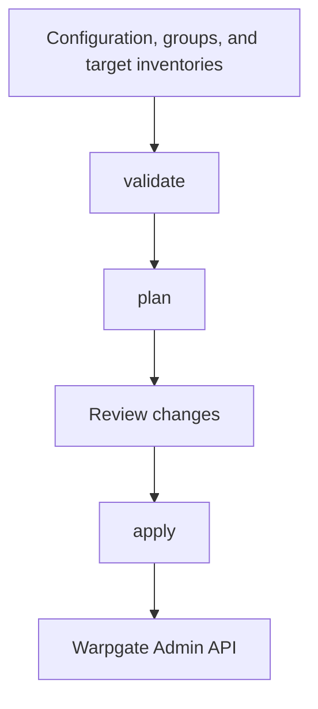

# Warpgate Admin

`warpgate-admin` manages Warpgate Target Groups, MySQL / PostgreSQL database targets, HTTP targets, and role associations through declarative inventories.

- `warpgate-admin.yaml`: connection credentials, inventory paths, and synchronization policies.
- `groups.csv`: groups managed in the current environment.
- `database-targets.csv`: database connections and roles.
- `http-targets.yaml`: HTTP URLs, TLS settings, domains, headers, and roles.

Configure at least one database or HTTP inventory. HTTP-only management is supported.

For Redis terminal access, see the [redis-toolbox deployment and operations guide](docs/redis-toolbox.md), covering OS accounts, shared configuration, SSH forced commands, and Warpgate integration.

## Warpgate version compatibility

Compatibility covers the existing Target Group, MySQL / PostgreSQL / HTTP Target, and role assignment workflows. See the [API compatibility guide](docs/warpgate-compatibility.md) for the version matrix, verification steps, and limitations.

Starting with 0.29.0, Target creation and updates must explicitly include `ticket_requests_disabled`, `ticket_require_approval`, and `require_approval`. New targets retain the earlier defaults of `false` for all three fields; updates preserve existing server policies. Fields absent from older responses use their respective defaults. Existing inventory formats do not need to change.

Validate upgrades with `plan → apply → plan` against dedicated test targets. Confirm that the second plan has no unexpected changes and that existing approval policies remain intact. Running `plan` alone does not verify write requests against the new API requirements.

Run unit regression tests with `go test ./...`. For optional container integration tests, run `python3 scripts/test-warpgate-compatibility.py` with local Docker and the corresponding official images. This script is not required for normal CLI operation and is not invoked by `go test`.

## Workflow

```text
Configuration + groups + database/HTTP inventories
                         |
                      validate
                         |
                        plan
                         |
                   Review changes
                         |
                       apply
                         |
                Warpgate Admin API
```



- `validate`: checks local files without accessing Warpgate or resolving password and header environment variables.
- `plan`: queries existing resources, resolves credentials, and displays creates `+`, updates `~`, and deletions `-`.
- `apply`: recalculates and applies the plan. Resource names are stable reconciliation keys; applying the same inventory repeatedly should produce no additional changes.

`plan` never prints passwords or header values. Failed HTTP writes report the API status and hide response bodies that might echo credentials.

## Test and production environments

Maintain separate configurations and inventories:

```text
data/
+-- test/
|   +-- warpgate-admin.yaml
|   +-- groups.csv
|   +-- database-targets.csv
|   +-- http-targets.yaml
+-- prod/
    +-- warpgate-admin.yaml
    +-- groups.csv
    +-- database-targets.csv
    +-- http-targets.yaml
```

Use the shared templates in [data/example](data/example/) to initialize separate test and production inventories. To initialize a test environment, copy the templates into an unused directory:

```shell
mkdir -p data/test
cp -n warpgate-admin.example.yaml data/test/warpgate-admin.yaml
cp -n data/example/groups.example.csv data/test/groups.csv
cp -n data/example/database-targets.example.csv data/test/database-targets.csv
cp -n data/example/http-targets.example.yaml data/test/http-targets.yaml
chmod 600 data/test/warpgate-admin.yaml
```

In the copied configuration, set the inventory paths to `groups.csv`, `database-targets.csv`, and `http-targets.yaml`, relative to that configuration file. Repeat these steps with `data/prod` for production. Replace the example domains, names, roles, and credentials in each environment before running:

```shell
./warpgate-admin validate --config data/test/warpgate-admin.yaml
./warpgate-admin plan --config data/test/warpgate-admin.yaml
./warpgate-admin apply --config data/test/warpgate-admin.yaml

./warpgate-admin plan --config data/prod/warpgate-admin.yaml
```

If both environments share a Warpgate instance, use non-overlapping Groups and globally unique target names, preferably with environment prefixes. Directory names do not provide isolation; the configured groups and inventory types determine the deletion scope.

`data/test/`, `data/prod/`, and runtime configurations are excluded from Git by default. `data/example/` contains templates only. To version actual inventories, place files without plaintext credentials in a separate directory and adjust the configured paths.

## YAML configuration

```yaml
warpgate:
  host: https://<warpgate-host>
  token: <warpgate-token>
  insecure_skip_verify: false

inventory:
  groups: groups.csv
  database_targets: database-targets.csv
  http_targets: http-targets.yaml

apply:
  update_passwords: false
  sync_roles: false
  sync_database_targets: false
  sync_http_targets: false
```

Relative inventory paths are resolved from the configuration file's directory. `groups` is required, along with at least one of `database_targets` or `http_targets`. Unknown fields, duplicate fields, and multiple YAML documents are rejected.

`warpgate.host` accepts an instance root URL or an API URL containing `/@warpgate/admin/api`. `plan` and `apply` require `host` and `token`; `validate` does not require connection settings. Connection settings are read only from YAML and cannot be overridden by environment variables.

`insecure_skip_verify` controls certificate verification for the Admin API independently of target TLS settings. Certificate verification is enabled by default.

## groups.csv

| Column | Required | Description |
| --- | --- | --- |
| `enabled` | No | Defaults to `true` when empty. Groups set to `false` are excluded from synchronization. |
| `name` | Yes | Unique group name, up to 255 characters. |
| `description` | No | Group description. |
| `color` | No | `Primary`, `Secondary`, `Success`, `Danger`, `Warning`, `Info`, `Light`, or `Dark`. |

See the [group template](data/example/groups.example.csv).

## database-targets.csv

| Column | Required | Description |
| --- | --- | --- |
| `enabled` | No | Defaults to `true` when empty. Rows set to `false` are excluded from the desired inventory. |
| `group` | Yes | An enabled group in the current groups.csv. |
| `name` | Yes | Unique target name, up to 255 characters. |
| `description` | No | Target description. |
| `roles` | No | Existing Warpgate role names separated by `;`. |
| `engine` | Yes | `mysql` or `postgres`. |
| `host` | Yes | Database hostname without a port. |
| `port` | Yes | A number from `1` to `65535`. |
| `username` | Yes | Database username. |
| `password` | Conditionally | Plaintext password. Cannot be set together with `password_env`. |
| `password_env` | Conditionally | Password environment variable name. PostgreSQL requires one password source; MySQL allows an empty password. |
| `tls_mode` | No | `disabled`, `preferred`, or `required`. Defaults to `required`. |
| `tls_verify` | No | Defaults to `true`. |
| `default_database_name` | No | Default database name. |
| `protocol_version` | No | PostgreSQL supports `3.0` or `3.2`. When empty, preserves the existing target's version, or uses `3.2` for a new target or a legacy response without a version. Writes always include the resolved version. Must be empty for MySQL. |

See the [database template](data/example/database-targets.example.csv). Every template column except `roles` must be present. Columns may appear in any order; unknown columns are rejected and blank rows are ignored. Cells may be left empty as described above.

Use `password_env` for inventories committed to Git. Store local inventories containing plaintext passwords in ignored `*.local.csv` files.

When Warpgate returns an encrypted password, its plaintext cannot be compared with the inventory. The default behavior remains idempotent. To rotate passwords on existing database targets, temporarily enable the following policy in the environment's YAML configuration:

```yaml
apply:
  update_passwords: true
```

Review and apply the resulting updates:

```shell
./warpgate-admin plan --config data/test/warpgate-admin.yaml
./warpgate-admin apply --config data/test/warpgate-admin.yaml
```

Set `apply.update_passwords` back to `false` after rotation. This option forces updates only for database targets; HTTP targets are unaffected. New database targets always receive their configured passwords.

## http-targets.yaml

```yaml
targets:
  - name: "<http-target-name>"
    group: "<group-name>"
    description: "<description>"
    roles:
      - "<role-name>"
    url: https://service.example.invalid
    tls:
      mode: required
      verify: true
    external_host: service.warpgate.example.invalid
    headers:
      X-Example: "<header-value>"
    headers_env:
      Authorization: HTTP_AUTHORIZATION
```

See the [HTTP template](data/example/http-targets.example.yaml). HTTP API fields follow the [Warpgate documentation](https://warpgate.null.page/targets/http/). This tool adds `headers_env` to resolve environment variable references into Warpgate's `headers` map.

| Field | Description |
| --- | --- |
| `enabled` | Optional; enabled by default. `false` excludes the entry from the desired inventory. |
| `name`, `group` | Required. Target names must also be unique across database and HTTP inventories. |
| `description` | Optional; omission means an empty description. |
| `roles` | Optional role list; see the next section for synchronization behavior. |
| `url` | Required absolute HTTP(S) URL. Ports and paths are allowed; usernames, passwords, and fragments are rejected. |
| `tls.mode` | Defaults to `disabled` for HTTP and `required` for HTTPS. HTTPS also accepts explicit `preferred`. Conflicting schemes and modes are rejected. |
| `tls.verify` | Defaults to `true`. Set explicitly to `false` for an internal service with a self-signed certificate if needed. |
| `external_host` | Optional bound domain without a scheme, port, or path. Omission preserves the current value; `""` clears the binding. Configure DNS and certificates separately. |
| `headers` | Map of literal request headers. |
| `headers_env` | Map of header names to environment variable names. Each variable holds the complete header value, such as a complete Bearer authorization value. |

Omitting both `headers` and `headers_env` preserves existing headers. Configuring either map makes their combined contents the complete desired header set. Use `headers: {}` to clear headers explicitly. Header names are case-insensitive; duplicates, conflicting sources, invalid names, and control characters are rejected. Empty or unset environment variables cause `plan` and `apply` to fail before any writes.

An empty HTTP inventory must explicitly contain `targets: []`. Empty files, missing `targets`, and invalid YAML are rejected so that input mistakes cannot be interpreted as requests to delete all targets.

## Role and deletion synchronization

`apply.sync_roles` defaults to `false`, adding only missing associations. When enabled:

- Omitting the database `roles` column or the HTTP `roles` field preserves existing roles.
- Providing roles synchronizes associations to the complete desired set.
- An empty database `roles` cell or HTTP `roles: []` clears role associations.

Roles must already exist, and the API token must have the required permissions.

`sync_database_targets` and `sync_http_targets` both default to `false` and control deletion only for their respective types. When enabled, the deletion scope consists of targets of that type in the currently enabled Groups that are absent from the desired inventory, including entries marked `enabled: false`.

**If an inventory type is not configured, targets of that type are neither managed nor deleted, even when its synchronization option is enabled.** Missing or invalid configured files fail the entire operation before any writes. An explicitly empty inventory can clear its corresponding scope; review `plan` first.

The tool never deletes Groups, SSH targets, or Kubernetes targets, and it refuses to change the protocol of a same-named target. Updates preserve unmanaged rate limits, session approval requirements, and ticket policies. With deletion synchronization enabled, a rename appears as creating the new name and deleting the old one.

The Warpgate Admin API does not provide transactions. If `apply` fails partway through, successful operations are not rolled back automatically. Fix the error and rerun `plan` and `apply`.

## CLI

`validate`, `plan`, and `apply` require `--config`. All inventory paths and apply policies come from that YAML file; command-line overrides are not supported. Use `apply.sync_database_targets` and `apply.sync_http_targets` to control deletion for each type. Previous generic inventory and synchronization names are no longer accepted.

```shell
./warpgate-admin validate --config data/test/warpgate-admin.yaml
./warpgate-admin plan --config data/test/warpgate-admin.yaml
./warpgate-admin apply --config data/test/warpgate-admin.yaml
./warpgate-admin help
./warpgate-admin version
```

`help`, `version`, and command help do not require a configuration file. For local validation, a minimal configuration can contain only inventory paths:

```yaml
inventory:
  groups: groups.csv
  http_targets: http-targets.yaml
```

Run `validate --config <path>` to check those files without connection credentials, environment variable resolution, or API access.

## Build and test

Go 1.26 or later is required.

```shell
go build -o warpgate-admin ./cmd/warpgate-admin
go test ./...
go test -race ./...
```
