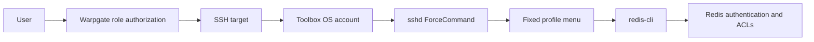

# redis-toolbox deployment and operations guide

`redis-toolbox` provides an interactive Redis terminal through Warpgate SSH targets. Each OS account is bound to a profile. After signing in, users select a target and enter `redis-cli`.

The session entry point is [`scripts/redis-toolbox-session.py`](../scripts/redis-toolbox-session.py), and the configuration template is [`data/example/redis-targets.example.yaml`](../data/example/redis-targets.example.yaml). This workflow is separate from the database and HTTP inventories managed by `warpgate-admin`, which currently does not create or synchronize SSH targets.

## Access flow and permission boundaries

```text
User -> Warpgate role authorization -> SSH target -> Toolbox OS account
                                                             |
                                                      sshd ForceCommand
                                                             |
                                                    Fixed profile menu
                                                             |
                                                         redis-cli
                                                             |
                                                Redis authentication and ACLs
```



The previous deployment used the shared group `redis-toolbox` with GID `1001` and the account mappings below. These values record that deployment; choose appropriate names and an unused GID for a new environment.

| Environment | OS account | Fixed profile |
| --- | --- | --- |
| Test | `redis-test-rw` | `test-rw` |
| Production | `redis-prod-rw` | `prod-rw` |

`environment` and `permission` are display labels in the menu. Setting a label to `READ-WRITE` or `READ-ONLY` does not change Redis permissions. Redis ACLs determine which commands and keys the user can access.

A profile limits only the initial menu. The interactive `CONNECT` command in `redis-cli` can switch connections, and cluster mode follows node redirects. Environment isolation therefore also requires network access controls and separate Redis credentials. See the [Redis CLI documentation](https://redis.io/docs/latest/develop/tools/cli/).

## Prerequisites and deployment parameters

Run the commands below on the toolbox host. When installing the script, use this repository's root as the working directory. The examples target Debian / Ubuntu with systemd; verify package names, the SSH service name, and the CA certificate path on other distributions. Keep an existing administrator SSH session open until verification through a new connection succeeds.

Dependencies include OpenSSH Server, Python 3, PyYAML, a TLS-enabled `redis-cli`, and CA certificates:

```shell
sudo apt-get update
sudo apt-get install python3 python3-yaml redis-tools ca-certificates openssh-server

/usr/bin/env python3 -c 'import yaml; print(yaml.__version__)'
/usr/bin/redis-cli --version
/usr/bin/redis-cli --help
test -r /etc/ssl/certs/ca-certificates.crt
```

Confirm that `redis-cli --help` lists `--tls`, `--cacert`, `--askpass`, `--user`, and `-c`. The script currently uses `/usr/bin/redis-cli` and `/etc/ssl/certs/ca-certificates.crt`. Neither path has a command-line override; adapt the script's centralized constants before deploying to hosts with different paths.

The toolbox host must resolve Redis hostnames and reach their configured ports. In cluster mode, it must also reach each node returned by redirects. Warpgate must be able to reach the toolbox host's SSH port.

Set the following variables in the same administrator shell. Replace every `<...>` placeholder with an actual value, and use matching values for the corresponding placeholders in the YAML and sshd configuration below:

```shell
TOOLBOX_GROUP='redis-toolbox'
TOOLBOX_GID='<unused-gid>'
TEST_USER='<test-os-user>'
PROD_USER='<prod-os-user>'
TEST_PROFILE='<test-profile>'
PROD_PROFILE='<prod-profile>'
SSH_SERVICE='<ssh-service-name>'
WARPGATE_SOURCE_IP='<warpgate-source-ip>'
WARPGATE_SOURCE_HOST='<warpgate-source-hostname>'
```

Set `SSH_SERVICE` to the host's service name: Debian / Ubuntu commonly use `ssh`, while some distributions use `sshd`. Use only letters, digits, hyphens, or underscores in account and profile names, with distinct names for the two environments.

## Create the OS group and accounts

Check the existing state first:

```shell
getent group "$TOOLBOX_GROUP"
getent group "$TOOLBOX_GID"
getent passwd "$TEST_USER"
getent passwd "$PROD_USER"
```

Create the group and accounts only if they do not already exist and the GID is unused. For existing entries, verify their ownership and group membership, then skip the corresponding creation commands. Do not change an existing group's GID merely to match the previous deployment.

```shell
sudo groupadd --gid "$TOOLBOX_GID" "$TOOLBOX_GROUP"
sudo useradd --create-home --shell /bin/bash --gid "$TOOLBOX_GROUP" "$TEST_USER"
sudo useradd --create-home --shell /bin/bash --gid "$TOOLBOX_GROUP" "$PROD_USER"
sudo passwd --lock "$TEST_USER"
sudo passwd --lock "$PROD_USER"

id "$TEST_USER"
id "$PROD_USER"
```

Keep these accounts out of administrative groups such as sudo. Retain `/bin/bash` because sshd uses the login shell to execute `ForceCommand`; do not replace it with `nologin`. Locking a password does not guarantee that public-key login remains available. Verify login against the host's PAM and account policies.

## Install the session script and shared configuration

```shell
sudo install -d -m 755 -o root -g root /usr/local/libexec
sudo install -m 755 -o root -g root \
  scripts/redis-toolbox-session.py /usr/local/libexec/redis-toolbox-session
sudo install -d -m 750 -o root -g "$TOOLBOX_GROUP" /etc/redis-toolbox
```

Install the template on the first deployment. If the configuration already exists, back it up and edit it instead of overwriting it with the template:

```shell
sudo install -m 640 -o root -g "$TOOLBOX_GROUP" \
  data/example/redis-targets.example.yaml /etc/redis-toolbox/targets.yaml
sudoedit /etc/redis-toolbox/targets.yaml
```

The following example defines two profiles. Replace the placeholders, example hostnames, and target settings. Each profile's `targets` list must reference IDs defined in the top-level `targets` mapping.

```yaml
version: 1

profiles:
  <test-profile>:
    environment: "<test-environment-label>"
    permission: "<permission-label>"
    targets:
      - <test-target-id>
  <prod-profile>:
    environment: "<prod-environment-label>"
    permission: "<permission-label>"
    targets:
      - <prod-target-id>

targets:
  <test-target-id>:
    display_name: "<test-target-display-name>"
    host: redis-test.example.invalid
    port: 6379 # Default Redis port; adjust to match the target.
    tls: true
    cluster: false
    auth:
      mode: prompt
  <prod-target-id>:
    display_name: "<prod-target-display-name>"
    host: redis-prod.example.invalid
    port: 6379 # Default Redis port; adjust to match the target.
    tls: true
    cluster: true
    username: "<redis-acl-username>"
    auth:
      mode: prompt
```

| Field | Current behavior |
| --- | --- |
| `version` | Must be `1`. |
| `profiles` | At least one profile is required. Each entry contains `environment`, `permission`, and a `targets` list. An empty target list passes configuration validation but cannot start a session. |
| `display_name`, `host`, `port` | Required. The port must be between `1` and `65535`. |
| `tls`, `cluster` | Required booleans controlling TLS and `redis-cli -c`, respectively. |
| `username` | Optional; passed to `redis-cli --user` when set. This is the Redis ACL username, separate from the OS account. |
| `auth.mode: prompt` | The default mode; prompts for a password using `--askpass`. |
| `auth.mode: static-password` | Reads a plaintext password from `auth.password` and passes it to the child process through `REDISCLI_AUTH`. |

If a static password is required, replace the target's `auth` mapping with the following. Put the actual password only in the access-controlled configuration on the host; do not commit it to Git:

```yaml
auth:
  mode: static-password
  password: "<redis-password>"
```

The script does not expand environment variables in YAML and does not support `password_env`. Passwords must be placed under `auth.password`; top-level target fields named `password`, `auth_token`, `secret`, or `token` are rejected.

With a shared file, both OS accounts have permission to read the entire configuration, including any static passwords. If credentials must be isolated, use separate configuration files and read permissions, and point each account's `ForceCommand --config` to its own file.

After editing, confirm permissions and validate the configuration as both accounts:

```shell
sudo chown root:"$TOOLBOX_GROUP" /etc/redis-toolbox /etc/redis-toolbox/targets.yaml
sudo chmod 750 /etc/redis-toolbox
sudo chmod 640 /etc/redis-toolbox/targets.yaml
sudo chown root:root /usr/local/libexec/redis-toolbox-session
sudo chmod 755 /usr/local/libexec/redis-toolbox-session

sudo -u "$TEST_USER" /usr/local/libexec/redis-toolbox-session \
  --config /etc/redis-toolbox/targets.yaml --validate-config
sudo -u "$PROD_USER" /usr/local/libexec/redis-toolbox-session \
  --config /etc/redis-toolbox/targets.yaml --validate-config
```

Both commands should print `Configuration is valid`. This check reads and validates the entire configuration, but it does not verify a supplied `--profile`, DNS, network connectivity, certificates, or Redis passwords. Confirm profile availability and menu contents during interactive verification below.

## Configure sshd forced commands

For new accounts, activate forced commands before installing public keys. If an existing account already allows login, suspend its Warpgate entry until configuration and verification are complete.

Back up the main configuration first and keep track of the backup path:

```shell
SSHD_BACKUP="/etc/ssh/sshd_config.redis-toolbox.$(date +%Y%m%d%H%M%S).bak"
sudo cp -p /etc/ssh/sshd_config "$SSHD_BACKUP"
sudoedit /etc/ssh/sshd_config
```

Place the configuration below after the global directives in the main configuration file. Check whether existing `Include` and `Match` directives affect these accounts. If an account matches multiple blocks, the first matching value for each option takes effect; avoid appending duplicate blocks without checking their order. This is configuration text, so shell variables are not expanded. Replace the placeholders manually:

```text
Match User <test-os-user>
    ForceCommand /usr/local/libexec/redis-toolbox-session --config /etc/redis-toolbox/targets.yaml --profile <test-profile>
    AuthenticationMethods publickey
    PubkeyAuthentication yes
    PasswordAuthentication no
    KbdInteractiveAuthentication no
    DisableForwarding yes
    PermitTTY yes
    PermitTunnel no
    PermitUserRC no
    X11Forwarding no
    AllowAgentForwarding no

Match User <prod-os-user>
    ForceCommand /usr/local/libexec/redis-toolbox-session --config /etc/redis-toolbox/targets.yaml --profile <prod-profile>
    AuthenticationMethods publickey
    PubkeyAuthentication yes
    PasswordAuthentication no
    KbdInteractiveAuthentication no
    DisableForwarding yes
    PermitTTY yes
    PermitTunnel no
    PermitUserRC no
    X11Forwarding no
    AllowAgentForwarding no

Match all
```

`ForceCommand` handles shell, remote-command, and subsystem requests; forwarding must be disabled separately. `Match all` ends the preceding user-specific scope, but subsequent directives must still be allowed inside a Match block. Keep global directives before the first Match block. See the [OpenSSH sshd_config manual](https://man.openbsd.org/sshd_config).

Check the syntax and effective configuration for both accounts:

```shell
sudo /usr/sbin/sshd -t
sudo /usr/sbin/sshd -T \
  -C "user=$TEST_USER,host=$WARPGATE_SOURCE_HOST,addr=$WARPGATE_SOURCE_IP"
sudo /usr/sbin/sshd -T \
  -C "user=$PROD_USER,host=$WARPGATE_SOURCE_HOST,addr=$WARPGATE_SOURCE_IP"
```

Confirm that each `forcecommand` selects the intended profile and that the effective settings include `authenticationmethods publickey`, `pubkeyauthentication yes`, `passwordauthentication no`, `kbdinteractiveauthentication no`, `disableforwarding yes`, `permittty yes`, `permittunnel no`, and `permituserrc no`. If the configuration uses `Match LocalAddress` or `LocalPort`, also provide the actual `laddr` and `lport` values in `-C`. Check that administrator accounts retain login access and that the effective `authorizedkeysfile` includes `.ssh/authorized_keys`.

Reload only after validation succeeds:

```shell
sudo /usr/sbin/sshd -t && sudo systemctl reload "$SSH_SERVICE"
sudo systemctl is-active "$SSH_SERVICE"
```

## Install the Warpgate SSH public key

Obtain the public key used for target connections from Warpgate's SSH keys administration page. Both OS accounts can trust the same key. Use Warpgate's outbound client public key, rather than an SSH host key or a personal login key. See the [Warpgate SSH target documentation](https://warpgate.null.page/targets/ssh/).

The previous deployment used `awk` to extract the first matching key from `/home/redis-toolbox/.ssh/authorized_keys`. That method discards options such as `from=`, `restrict`, and `command=`, and the first key in a file containing multiple keys may not be the one Warpgate currently uses. When reusing an existing file, verify the fingerprint and review which restrictions to retain. A public-key entry that disables PTY allocation will also affect interactive sessions.

Save the reviewed public-key entry to a file on the host and set its path below. These commands are intended for new accounts and overwrite the destination `authorized_keys`. For existing accounts, back up the file and merge the required entries instead.

```shell
WARPGATE_PUBLIC_KEY_FILE='<absolute-path-to-reviewed-public-key-file>'
ssh-keygen -lf "$WARPGATE_PUBLIC_KEY_FILE"

for TOOLBOX_USER in "$TEST_USER" "$PROD_USER"; do
  TOOLBOX_USER_HOME="$(getent passwd "$TOOLBOX_USER" | cut -d: -f6)"
  if [ -z "$TOOLBOX_USER_HOME" ] || [ "$TOOLBOX_USER_HOME" = / ]; then
    printf 'Cannot determine the home directory for account: %s\n' "$TOOLBOX_USER" >&2
    break
  fi
  sudo install -d -m 700 -o "$TOOLBOX_USER" -g "$TOOLBOX_GROUP" \
    "$TOOLBOX_USER_HOME/.ssh" || break
  sudo install -m 600 -o "$TOOLBOX_USER" -g "$TOOLBOX_GROUP" \
    "$WARPGATE_PUBLIC_KEY_FILE" "$TOOLBOX_USER_HOME/.ssh/authorized_keys" || break
done
```

Changes to `authorized_keys` alone do not require an sshd reload. Do not copy Warpgate's private key to configure the target host.

## Configure Warpgate and verify interactive access

Create two SSH targets in Warpgate. For each target, configure the toolbox host address, SSH port, public-key authentication, and the corresponding test or production OS account. Assign roles that are allowed to access that environment. The SSH target username is the OS account, not the Redis ACL username. Verify the toolbox host's SSH host-key fingerprint on the first connection.

First verify each profile from an administrator terminal on the toolbox host. This step opens real Redis connections:

```shell
sudo -u "$TEST_USER" /usr/local/libexec/redis-toolbox-session \
  --config /etc/redis-toolbox/targets.yaml --profile "$TEST_PROFILE"
sudo -u "$PROD_USER" /usr/local/libexec/redis-toolbox-session \
  --config /etc/redis-toolbox/targets.yaml --profile "$PROD_PROFILE"
```

Run one session at a time, select a target, and enter the Redis password when using `prompt` mode. Run `PING` and expect `PONG`; if the ACL does not permit `PING`, verify access with an approved read-only command. Run `QUIT` before testing the other account. Do not write production data to verify access.

Next, open interactive terminals through Warpgate as a user authorized only for test access and as a user authorized for production access. Confirm that:

- Warpgate shows only the SSH targets authorized for that user. Users without a production role cannot access the production entry.
- The environment and permission labels are correct, the menu lists only the profile's targets, and authentication succeeds after selecting a target.
- Shell and remote-command requests launch toolbox instead of a general-purpose shell. SFTP does not provide file access, and port forwarding is denied.
- `QUIT` ends the SSH session without returning to an OS shell. Existing administrators can still establish new SSH connections.

The script launches `redis-cli` using `os.execve` and points `REDISCLI_HISTFILE` and `REDISCLI_RCFILE` to `/dev/null`. The displayed Session ID is generated by the script and is not a Warpgate session ID. The script does not persist audit logs; verify Warpgate session recording separately if auditing is required.

## Updates, troubleshooting, and rollback

The configuration is read when each toolbox session starts. Updating only `targets.yaml` does not require an sshd reload. Validate the configuration and open a new session to verify it; existing sessions do not automatically switch targets. Changes to the account, profile, or configuration path in sshd require another `sshd -t`, `sshd -T -C`, and reload.

| Symptom | What to check |
| --- | --- |
| `No module named yaml` | Confirm that PyYAML is installed for the Python interpreter selected by the script's shebang, rather than only in an administrator's virtual environment. |
| `Unable to load configuration` | Check the path, YAML syntax, directory mode `750`, file mode `640`, and account group membership. |
| `Redis profile is not available` | The `ForceCommand --profile` value does not match a profile key in YAML. `--validate-config` does not detect this mismatch. |
| `No Redis targets are configured for this profile` | The profile's target list is empty. |
| `Interactive terminal is required` | Use an interactive terminal and check `PermitTTY` and any PTY restrictions in the public-key entry. |
| Public-key authentication fails | Check the outbound key, target username, `AuthorizedKeysFile`, directory permissions, PAM / account-locking policies, and sshd logs. |
| Login opens a general-purpose shell | Check the actual login account, Match order, and `sshd -T -C` output. Confirm that the configuration was reloaded. |
| TLS, authentication, or cluster redirects fail | Check CA certificates, the Redis username and password, ACLs, target node addresses, and network connectivity. |

Read the SSH service logs:

```shell
sudo journalctl -u "$SSH_SERVICE" --since today
```

Before making changes, keep access-controlled backups of the script and configuration. Backups containing static passwords need the same access restrictions as the original files. To roll back, first suspend the affected Warpgate entries and revoke public-key access for the new accounts, then restore the relevant script, YAML, or sshd backups. Validate the restored configuration, run `sshd -t`, reload where needed, and verify through new connections. Removing only `ForceCommand` while leaving public keys in place may grant general-purpose shell access. Revoking entries and public keys does not automatically terminate existing sessions.
